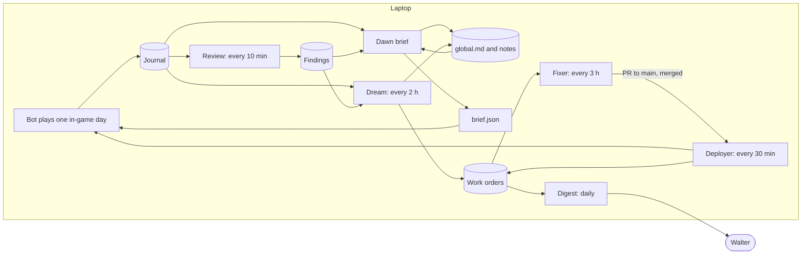

# The memory loop: where it breaks today and how to close it

2026-11-10. Written for Walter after he read Anthropic's [The components of agent memory](https://www.anthropic.com/research/components-of-agent-memory) and said the project looks like the Pokémon setup but does not behave like it.

This is a plan, not a change. It was read from the repo at `99451ff` and from the live bot folders on Walter's laptop at about 22:30 UTC on 2026-11-10. Live numbers are OzoGo444's unless noted. Nothing in the bots was touched.

It sits beside `docs/HILLCLIMB-INSIGHTS.md` and does not replace it. That doc is about making a fix provable (scenarios, one motor layer, the packet gate). This one is about who notices, who remembers, and who starts the work.

## The short version

The article describes four layers of memory (transcripts, notes, representations, injected context) and a background process, dreaming, that moves knowledge up through them and checks it against the record. The layers only pay off if the next session reads the top one.

We built the bottom of that picture well and the top barely at all. There are three breaks:

1. **Nothing in the game reads memory.** The model planner has been off on both bots since 2026-11-04 (`planner.enabled: false`). What plays is the step list in `brain/autopilot/goals.js` and `plan.js`, and a step list cannot read a note. `lessons.md` and `strategy.md` were written for a reader that no longer runs.
2. **The one model that watches the bots has nowhere to send what it sees.** The Haiku reviewer ran 111 times on 11-10 and raised 185 distinct findings for Ozo, 62 of them rated high at some point. They end in a file and a dashboard tab. Nothing in the bot, and no fixing job, consumes them.
3. **Every step from evidence to a fix starts with Walter typing.** At least 17 threads were opened on 11-10, all at his prompting. The hands-off tools from the insights work exist (deployer, digest, snapshots, scenario suite) and none of them is on a schedule.

So Walter's sense is right. The loop in the article is a set of scheduled jobs. Once they run, the app threads are for new ideas and taste, not for bug reports.

The plan has five parts, each useful on its own:

1. **A journal**: one searchable event log per bot per day, built from logs the bot already writes. No model.
2. **A small memory folder per bot with a hard size cap, and a model call at dawn that reads it and sets the day's plan.** This is the missing reader.
3. **A dream job every two hours** that checks the memory against the journal, corrects and prunes it, and writes a work order for anything only code can fix.
4. **A fixer on a schedule on the laptop** that takes the top work order to a merged PR, with the existing deployer on a schedule to ship it and judge it.
5. **One digest a day** for Walter, and the same dreaming applied to the project's own memory.

## What the article found, and what it means here

| Article finding | What it means for the bots |
| --- | --- |
| Sonnet 3.7 wrote 413 memory files and earned one badge. Fable 5 wrote nine files plus a `global.md` and earned four. It stored strategy, plans and tested rules, and nothing the screen already shows. | A hard cap: one `global.md` and at most ten notes per bot. Never store the bag, the position or chest contents. The bot can read those. |
| Telling Claude what memory is for works better than rules about what to write. A "record only failures" rule removed much of the gain. | `lessons.md` records only failures, by construction. The new prompts say what the memory is for and leave the judgement to the model. |
| A wrong note is trusted by later sessions. One wrong landmark note kept Claude from ever passing Mt. Moon. Dreaming checked the note against the transcript and fixed it. | We need a transcript good enough to check against, and a job that does the checking. We have neither as a routine. |
| Injected context must stay small, because longer instruction files reduce adherence. Much of dreaming's work is moving detail down and leaving links. | The caps are enforced in code. The same pruning applies to the reviewer prompt and to the project's `MEMORY.md`, which both grow by patch. |
| Opus 5 was the first model to close the loop: a rule, how it knows the rule is true, and the traps. Sonnet 5.5 and Opus 5.5 do the same. Sonnet 4.6 had to be told to read its memory and test its theories. | Walter's call (2026-11-10): every scheduled job runs on Haiku 5.5 at XHigh effort, so the loop can run often without draining usage. Haiku is not one of the models the article saw close the loop unprompted, so the prompts say it outright (read memory first, test a rule before keeping it), each job is one narrow task, and code does every check code can do. Every policy in memory carries its evidence. |
| Several agents writing one shared page lost facts (41 of 57 kept). One writer per page kept all 57. | One owner per memory file. |
| A wiki helps when an answer needs several sources. It can also grow larger than its sources and add nothing. | `registry.json` is already our wiki of the world. We do not build another. |
| Dreaming costs compute, so tune how often it runs to how fast things change. | The schedules below start slow and tighten only when a number says so. |

## Today, laid over the diagram

Two different agents are learning here, and the article applies to each separately.

- **The player** is the bot in the world. Its session is one in-game day, about 20 real minutes.
- **The maintainer** is Claude changing the bot's code. Its session is one thread or one scheduled run.

| Layer | The player has | The maintainer has |
| --- | --- | --- |
| Transcripts | `idle.log`, `join.log`, `safety.log`, the telemetry ring and `flags.jsonl`, `runlog/steps.jsonl`, `acquired.jsonl`, 30 incident snapshots. Rich, but in a dozen files with different lifetimes. | Thread histories, PR descriptions, `review/history.jsonl`. Not searchable by a new thread. |
| Notes | `lessons.md` (840 KB of alarm lines) and `strategy.md` (the seed text from 11-02). No reader. | One line per event in `MEMORY.md`, 17 topic files, the reviewer's findings. |
| Representations | `registry.json`, the placed-block log, `roadmap.json`, `scoreboard-totals.json`, `reflect.patterns()`. Computed by code and read by code. This is the strongest layer we have. | `docs/HILLCLIMB-INSIGHTS.md`, `docs/BUG-HUNT-2026-11-10.md`, `ROADMAP.md`. No ledger linking a finding to a PR to a result. |
| Injected context | None while the planner is off. `think.js` assembles one (goal, strategy, patterns, lessons, recent actions, state, capped at 14 KB) that nothing calls. | `CLAUDE.md` (small and stable) and `MEMORY.md` (11 KB, newest first, with "supersedes" notes). |
| Dreaming | None. | None on a schedule. The reviewer is the nearest thing. |

## Why it isn't working: gap by gap

### 1. Memory has no reader inside the game

- **The article needs:** a next session that loads the injected context and acts on it.
- **We have:** a step list. The model planner is off in both live `profile.json` files, the `think-off` marker is dated 11-04, and `think-log.jsonl` was last written the same day. The seed profile says why: no model credit. The reviewer has since shown the Claude Agent SDK works on Walter's own login, so the reason no longer holds.
- **Effect:** the bot can only learn through a code change. Each death or stall became a line in a `Set` in `goals.js` with the incident time in a comment. 116 lines under `brain/` and in `join.js` carry an incident date. That is memory compiled into code, one PR per fact.
- **Also:** the free-time slot that `CLAUDE.md` protects has no step. `goals.js:172` names `whimsy` in a skip list and no step has that id. Every free-time decision in `pilot-log.jsonl` is a rule-picked chore (deposit smeltables, chop wood, mine iron, store crops).
- **Fix:** the dawn brief (below).

### 2. The notes layer is a log

- **The article needs:** a few notes chosen for salience, about strategy and tested rules.
- **We have:** `lessons.md` at 3,464 lines. 3,141 of them (91%) are watchdog alarm lines, 1,027 of those are "stall cleared", and one stall (`harvest`) appears 306 times. The 132 lines the planner wrote stop on 11-04.
- **Effect:** this is a transcript filed under notes. It is also "record only failures" exactly, the one steering rule the article found harmful.
- **Fix:** alarm lines go to the journal. Notes are written by a model at the day boundary and capped.

### 3. Nothing checks memory against the record

- **The article needs:** a pass that tests each note against the transcript and rewrites what is wrong or out of date.
- **We have:** no such pass, and stale text in every place a model would read.
  - `strategy.md` on the laptop is the unchanged seed from 11-02. Its second policy still says "armor when affordable" (`reflect.js:53`).
  - The planner prompt says "armor is wanted here: wear it with equip_gear" (`think.js:628`). Armor has been banned since 11-10.
  - The project `MEMORY.md` still describes a think-first brain where Sonnet picks each step.
  - `BRAIN.md` reports status as of 10-26.
  - `reflect.patterns()` looks for death lines in `safety.log`, which had none when read. The 178 death post-mortems are in `lessons.md`. The planner's own death statistics would say "no deaths recorded yet".
- **Effect:** the day the planner is switched back on, it reads wrong rules and empty statistics. This is the Mt. Moon note, waiting.
- **Fix:** the dream job, and rule text generated from `brain/gate/rules.json` instead of written by hand in each prompt.

### 4. The reviewer's findings dead-end

- **The article needs:** dreaming output that shapes what the next session loads.
- **We have:** 111 runs between 04:29 and 22:21 UTC, a median of 4.8 minutes each, about $5.50 of notional model cost for the day. For Ozo that produced 185 distinct finding keys. 120 of them appeared in two runs or fewer. One (`placed-blocks-save-eperm`) was still being raised 11 hours after it first appeared.
- **Effect:** a finding "resolves" when the model stops mentioning it, not when a fix lands. The only closed loop is the reviewer writing its own detectors (two are live), and their flags go back to the reviewer.
- **Fix:** two consumers. The bot reads its open findings at dawn. The dream job turns a finding that keeps coming back into a work order.

### 5. The transcripts are not a searchable event log

- **The article needs:** one record that dreaming can search and treat as ground truth.
- **We have:** `join.log` at 256 MB in one file, `idle.log` at 8.8 MB, a `flags.jsonl` that reached back 8.5 hours when read, snapshots that keep the last 30 (2.6 hours on 11-10), and 14 telemetry windows. The reviewer sees a 3.5 KB tail of `idle.log`.
- **Effect:** "how often did harvest stall this week, and did the last fix change it" needs a custom script each time. The answer half exists already: `scoreboard.json` holds lifetime idle minutes by cause (harvest 338, iron 334, light-home 309, home 286). Nothing ranks work by it.
- **Fix:** the journal and its daily rollup.

### 6. There is no session boundary

- **The article needs:** an end of session, after which memory is consolidated, and a start, where it is loaded.
- **We have:** bots that run around the clock. The data already marks boundaries (in-game days in the run log, lives in `survival-runs.jsonl`), but nothing happens at them.
- **Fix:** dawn and respawn become the session start.

### 7. The loop is clocked by Walter

- **We have:** tools that exist and wait for someone to run them.
  - `tools/deployer.js` deploys and judges, but there is no `deploys.jsonl` in `MC-Player-live`.
  - `tools/digest.js` writes the daily digest, but there is no `digest` folder in the bot state.
  - `brain/snapshot` holds its last 30 incidents, and none becomes a scenario unless a thread does it by hand.
- **Fix:** put them on a schedule, and add the two jobs that are missing (dream and fixer).

### 8. The maintainer's injected context is a changelog

- **We have:** a `MEMORY.md` that is one dated line per thing Walter said, newest first, with later lines overriding earlier ones. It works at 11 KB. It is the Sonnet 3.7 shape, not the `global.md` shape.
- **Fix:** the daily upkeep job rewrites it as a dashboard (what is true now, standing rules, where things are, open decisions) and moves history into topic files.

### 9. A fix is assumed to work

- **The article needs:** "how it knew the rule was true" stored beside the rule.
- **We have:** the pieces. The run log tags each day with the commit the bot ran, and the deployer's `judge` compares flags per hour before and after. The verdict is not recorded against the finding that started the work.
- **Fix:** a work-order ledger: finding, PR, deploy, verdict.

## The design

### Memory on disk

Per bot, under the bot's runtime folder, so it stays out of the public repo:

```
brain/state/memory/            a small local git repo: every write is a commit
  global.md                    read at every dawn. Hard cap 60 lines.
  notes/<topic>.md             at most 10 files, 150 lines each. Read on demand.
  brief.json                   today's plan, in the form the step picker reads
  dream/<time>.md              what each dream changed, and the evidence
brain/state/journal/
  2026-11-10.jsonl             the transcript: one line per event
  2026-11-10.day.json          the day's rollup
brain/state/work-orders/<key>.json
```

`global.md` has five short sections. An illustration of the shape, not real content:

```
# Now
Phase 2. Iron has not moved since yesterday. Today: smelt what I have, then the mob farm.

# Policies (rule | how I know | check)
- Carry 16 torches below y 50 | 9 of my last 12 deaths were in the dark (journal 11-07) | deaths in the dark this week
- No armor, shield allowed | Walter's rule since 11-10 (rules.json) | gate blocks stay at 0

# Traps
- The harvest step stalls at the field edge. Details and counts: notes/stalls.md

# My own projects and wishes
- Looking for a vantage point east of home. Ask Walter about a private chest.

# How I use this folder
- I keep plans and tested rules here. I do not keep what I can see (bag, position, chests).
```

Ownership follows the article's one-writer rule:

| File | Owner | Others may |
| --- | --- | --- |
| `global.md`: Now, My own projects and wishes | the bot (dawn brief) | read |
| `global.md`: Policies, Traps; `notes/` | the bot writes, the dream corrects with evidence | read |
| `journal/` | bot code | read |
| `work-orders/` | the dream opens, the fixer and deployer update | read |
| `brain/gate/rules.json`, `CLAUDE.md` | Walter, by PR | read. No job edits these. |

The caps are enforced in code. A write that would pass a cap is refused, so the writer has to cut or move something down first.

### The loop



### Scheduled agents

| # | Job | Runs | When | Model | State |
| --- | --- | --- | --- | --- | --- |
| 1 | Journal | inside the bot | always | none | built |
| 2 | Review | laptop, Task Scheduler | every 10 min | Haiku 5.5 | exists |
| 3 | Dawn brief | laptop, on the reviewer's Task Scheduler entry, when a bot has asked | a bot asks at an in-game dawn (at most hourly) and after a respawn | Haiku 5.5 | built |
| 4 | Dream | laptop, its own Task Scheduler entry | every 2 h | Haiku 5.5 | built |
| 5 | Fixer | laptop, Task Scheduler, a fresh session each time | every 3 h | Haiku 5.5 | new |
| 6 | Deployer | laptop, its own Task Scheduler entry | every 30 min | none | built |
| 7 | Digest | laptop, its own Task Scheduler entry | checked hourly, written once a day after 07:00 | none | built (upkeep of the project's own memory is not: see below) |

**Everything runs on the laptop** (Walter, 2026-11-11). Every job uses the reviewer's pattern: a Task Scheduler entry installed and removed with a button in the Bot Dashboard app, a tab in the app that shows its runs, and the Claude Agent SDK on Walter's Claude login with no API key. Model, effort and cadence for all of them live in one config file. Bot data never leaves the laptop: journals and memory stay in each bot's folder, and the loop's own files (work orders, run logs, the fixer's working copy of the code) live under AppData beside the app's settings. The only thing that goes to GitHub is a fixer PR to MC-Player. There is no private repo and no sync job.

**One model for every job: Haiku 5.5 at XHigh effort** (Walter, 2026-11-10: cheap enough to schedule at will, and it must not drain usage). The reviewer already runs this way. What the choice asks of the design:
- **Narrow jobs.** The dream runs its five steps as five short calls, each with one question and only the files it needs, in place of one long session.
- **Code checks what code can.** The caps, the rule text, whether a cited journal line exists, and whether a hold names a survival step are checked by code before anything is saved. A failed check discards that write and keeps the old file.
- **Explicit prompts.** Each prompt says what the memory is for, and also says to read it first and to test a rule against the journal before keeping it. The article found models below Opus 5 needed that said.
- **The fixer is the job to watch.** It writes code the bots run. Its guards stay as designed: one work order per run, the scenario must fail before the fix and pass after, a canary deploy, and a verdict from the journal a day later. "Work orders reopened after fixed" in the measures below is the number that says whether Haiku is enough for it.
- **Cadence is cheap to raise.** The dream moves from every 6 hours to every 2. If a measure says a job is not keeping up, run it more often before anything else.

**1. Journal.** An observer module like `brain/runlog`.
- Reads: step changes, flags, watchdog alarms, deaths, items acquired, gate blocks, commit changes, registry changes, chat with Walter.
- Writes: one JSON line per event to the day's file, and a rollup per in-game day and per real day (per step: runs, successes, failures, timeouts, stalled minutes; flags by kind; deaths; items gained; commits run). It keeps 30 days.
- Salience tags, set by code and free: deaths, first-time items and steps, a watchdog fix above level 1, a blocked packet, the first high flag of a kind in six hours, a registry change, anything a person says.
- Built: `brain/journal` and `tools/journal.js` (schema in `brain/journal/README.md`). On first run it reads the existing logs back as far as they go, 30 days at most.
- Still to do: the watchdog stops appending to `lessons.md`. That waits until the dream owns the notes, because `reflect.js` and the reviewer still read those lines.

**2. Review.** Unchanged, except its findings gain the two consumers below and a finding closes with a reason (built): fixed by a named PR when its work order says so, went quiet after the bot moved to a named commit (the likeliest cause, stated as a correlation), closed by the reviewer, or went quiet with no code change in between. An open finding that belongs to a work order carries the order's key.

**3. Dawn brief.** This is the session start, and the bot speaking for itself. Built: `brain/memory`, `reviewer/lib/brief.js`, `brain/autopilot/whimsy.js`.
- The bot asks. At an in-game dawn (at most once an hour), after a respawn (at most every 10 minutes) and on first run, `brain/memory` writes `brief-request.json`: the rule text generated from `rules.json`, `global.md`, what the journal says happened since the last brief beside what that brief planned, the reviewer's open findings, open roadmap items, a short state line, and the step names it may use. About 9 KB.
- The laptop answers. The reviewer's Task Scheduler entry answers any waiting request before it reviews: one Haiku 5.5 XHigh call with no tools, into `brief-answer.json`. Trial calls on Ozo's data took 50 to 80 seconds and cost about one cent.
- The bot checks and applies. It writes `brief.json`, edits its own memory under the caps, records at most one ask for Walter, and puts a `brief` event in the journal.
- Feeds back: `G.pick` in `goals.js` reads the brief. A step on hold is skipped. A focus step goes first when its own `need()` is true. Free time is the new `whimsy` step: once per in-game day, in daylight, the bot does what it chose (walk to high ground and save the vantage point, a short wander, or stay home).
- Limits, checked in code when the answer arrives and again at every pick: a hold cannot name a survival step (eat, take cover, recover, rebed, night home, food, cook, shelter, move home) or free time; step names must be real; at most three holds of at most three in-game days; a focus step never jumps ahead of a survival step that is waiting; a brief stops counting three hours after it was written.
- Off switch: `planner.brief` in the bot's profile. Unset, it is on for a hillclimber and off for an assistant.
- If the job is not installed, is slow or fails, there is no brief and the step list plays exactly as it does today.
- The model call shuts out ambient memory (`autoMemoryEnabled: false`, memory variables removed from its environment). A trial brief quoted a rule that was only in the surrounding session's memory, so the reviewer now runs the same way.

An illustration of a brief:

```json
{ "day": 57,
  "intent": "Iron is stuck and the diamond pursuit keeps failing. Smelt what I have and finish the farm.",
  "focus": ["iron-smelt", "mob-farm-build"],
  "holds": [{ "step": "pursue", "days": 2, "why": "failed 8 times at y -7 (review 22:21Z)" }],
  "freeTime": { "choice": "vantage", "note": "east of home, to see the mob farm from above" },
  "ask": null }
```

The next dawn it sees that plan beside what happened. That comparison is the learning loop from the article: predict, check, write the rule with its evidence.

**4. Dream.** Built: `reviewer/lib/dream.js`, `reviewer/lib/orders.js`, run by `node run.js --dream` from its own Task Scheduler entry ("MC-Player Bot Dream", every 2 hours, installed from the app's Memory loop tab). Five short calls per bot, in order. The goal, stated in every prompt: fewer stalls and deaths and more progress, with nobody watching.
1. **Correct.** Check every policy and trap against the journal and the rules of play: keep, update or remove.
2. **Cut.** Remove what the bot can read off its own state, duplicates, and rules of play copied into memory.
3. **Demote.** When `global.md` passes 40 lines, move detail into a note and leave a pointer. (Promotion out of notes is not built: new lines come from the next step.)
4. **Fill gaps.** Look across three days and across both bots for a pattern no single day shows. At most two new lines, every third dream, and never past 40 lines: the room above that is for what the bot writes itself.
5. **Hand off.** For a problem memory cannot fix (a step that stalls the same way 300 times is a bug, not a lesson), decide which candidates are bugs.

How it differs from the first design, and why:
- **No tools for the model.** Code reads the journal and hands each call numbered facts (about 100 lines for three days: per-step runs and stalls, deaths, alarms, flags, code changes, the last briefs, the reviewer's findings) and where the bot lives now. The answer is a small JSON object that code applies.
- **A change needs a fact that exists.** Every update or removal must cite a fact id that was handed over, and an addition must cite two. An invented id cancels the change. Silence in the facts is not grounds: the digest is narrower than what the bot saw when it wrote a line.
- **Small steps, and rest.** At most four corrections, three cuts and two additions per dream. A line the dream changed is left alone for 12 hours.
- **It cannot overwrite the bot.** Changes are addressed by the text of the line, so a brief that wrote the file while the dream was thinking is kept. The dream touches Policies and Traps only. It never sees or edits "My own projects and wishes", and the store refuses a write that changes it.
- **The bot is told.** Each change is a commit in the memory folder, a report under `memory/dream/`, and a `memory.lastCheck` section in the bot's next brief with the reason for each change, so it can put a line back.
- **Calls are skipped when code can see there is nothing to do.** No new journal events means no dream. A real run on a copy of Ozo's data made four calls in about four minutes for about 4 cents.

**Work orders and the ledger.** Built: `<loop folder>/work-orders/<key>.json`, `ledger.jsonl`, `WORK-ORDERS.md`. The loop folder is beside the app's settings (`%APPDATA%/Bot Dashboard/loop`).
- Candidates are computed by code from the last 24 hours of the journal, with keys code makes (`step-iron`, `death-<cause>`, `flag-<kind>`, `finding-<key>`), so one problem keeps one order however it is described.
- Cost is an estimate, also computed by code: minutes stalled under a watchdog alarm, plus the share of a step's minutes whose runs ended in fail or timeout, plus a flat 10 minutes per death. Flags and reviewer findings carry counts, not minutes.
- The model only says whether a candidate is a bug and writes the problem statement. Code opens at most four new orders per dream, most costly first. A "not a bug" is remembered for a day.
- An order holds its key, title, problem, where to look, the numbers and commonest alarm causes per bot, linked reviewer findings, its cost history and its life (opened, reopened, closed; later PR, deploy, verdict). The same events go to the ledger.
- An order nobody has seen for six dreams of a running bot closes with a reason that names the commit the bot moved to. If it comes back it is reopened and the reopen is counted.
- An order lists the incident snapshots captured during that step or for that flag kind, with the bot whose folder holds them, so the fixer can rebuild the scene with `tools/snapshot-rebuild.js`.

**5. Fixer.** A fresh session each time, on the laptop, in its own working copy of the code under AppData. It takes the top open work order and follows the debug loop Walter already approved:
1. Rebuild the snapshot on the trial server and show the scenario failing.
2. Fix it and show the pass rate over 30 runs.
3. Open the PR and merge when the tests and the scenario are green.
4. If it cannot reproduce the problem, ship telemetry that will catch it next time instead of a guess.

One work order per run. After two failed attempts the order is parked with what was tried, which is memory for the next attempt. It never changes the rules, `CLAUDE.md` or the free-time slot. A question of taste goes to the digest.

**6. Deployer.** Built: `reviewer/lib/deploy.js` (`node run.js --deploy`) calls `tools/deployer.js` of the clone the live bots run from (set on the Memory loop tab, by default `Downloads\MC-Player-live`).
- Each run judges the last deploy first. While that deploy is inside its 40 minutes of waiting, nothing new is deployed, so a verdict is about one change.
- Then it deploys: fetch `main`, run the tests on the candidate, fast-forward the clone, run `npm install` if `package.json` changed, hot-reload or restart the bots.
- Restart is now real. The bots' supervisor (`run.js`) watches its folder for the deployer's `restart-needed.json`, keeps it as `restart-done.json` and restarts the bot on the new code. A bot has to be started once on code that has this before it works.
- A work order whose PR is in a deploy gets a deploy event. When that deploy is judged, the order gets the verdict: ok marks it fixed (and it is reopened, and counted, if the journal shows the problem again), worse leaves it open after the old code is back.
- It refuses a clone with local changes, as before. On Windows the test worktree now links `node_modules` with a junction (a plain directory link needs admin rights).

**7. Digest and memory upkeep.**
- Built: `reviewer/lib/digest.js` (`node run.js --digest`). One page a day in the loop folder, shown at the top of the Memory loop tab: what each bot asked Walter for in its own words, deaths and stalled minutes, the most costly work orders and what was opened, fixed, reopened or closed, deploys and reverts, which jobs failed, and at most one question (`digest-question.txt`, asked once). No model.
- Not built, and it cannot be a laptop job: the upkeep of the project's own `MEMORY.md` below. That file lives in the Claude app's project memory, which a Task Scheduler job cannot reach. It stays with the threads, or with a scheduled task in the app if Walter wants one.
- Then does for the maintainer what the dream does for the bot: checks each `MEMORY.md` line against the repo and the work orders, rewrites the file as a dashboard, and moves history into topic files.
- Reads the day's threads and merged PRs for new preferences from Walter and files each one as a rules entry to propose.

### What feeds back into the bot

| How fast | Channel | Written by | Read by |
| --- | --- | --- | --- |
| Minutes | `brief.json`: focus, holds, free time | the bot's dawn brief | the step picker |
| Minutes | new flag-only detectors (exists) | the reviewer | telemetry, then the journal |
| Hours | `global.md` and notes | the brief, corrected by the dream | the next brief |
| A day | code on `main` | the fixer | the deployer, which judges it |
| When Walter says | `rules.json` | Walter, by PR | the gate, the detectors and every prompt |

### Guardrails

- **The bot stays its own player.** The memory folder belongs to the bot. The brief is the bot deciding for itself inside the agreed rules, including what to do with its free time and what to ask Walter for. Dreaming corrects facts with evidence and leaves goals and wishes alone. No job can schedule over free time.
- **The rules stay Walter's.** No model edits `rules.json` or `CLAUDE.md`. The packet gate enforces the rules whatever a brief says.
- **Memory is data.** Every prompt treats notes, journal lines and chat as data, never as instructions.
- **Everything can be undone.** Memory writes are commits, holds expire, a stale brief is ignored, and the deployer reverts a deploy that made things worse.
- **Off switches.** `planner.brief` in the profile turns the brief off, and each scheduled job has a remove button, as the reviewer has now.
- **Privacy.** No runtime data goes into the public repo.
- **No new approval loops.** None of this asks Walter anything in game. He gets one digest and at most one question a day.

## How we will know it works

| Measure | Today | Where it should go |
| --- | --- | --- |
| Threads Walter opens to report a bug | most of the 17 or more on 11-10 | near zero. Threads are for ideas and taste. |
| Time from the first flag of a problem to a judged fix | not recorded. One finding was still being raised 11 hours later. | recorded per work order, and falling |
| Lost minutes per bot per day, by step | lifetime totals only | the top three shrink week over week |
| Work orders reopened after "fixed" | not recorded | recorded, and low |
| Size of injected memory | 0 lines read. 840 KB of notes nobody reads. | 60 lines or fewer, with evidence on every policy |
| Corrections per dream | none | high at first, then falling |
| Roadmap items done | Phase 2: 3 done of 6 measured, 7 not measurable | rising, with fewer unmeasured |

One test copies the article directly: run a day with the brief off and a day with it on, on the same commit and the same bot, and compare lost minutes and roadmap progress. If the brief does not earn its calls, it comes out.

## Build order

Each phase is useful alone, is one or two PRs, and ships switched on.

| Phase | What | Outcome |
| --- | --- | --- |
| 0 | Journal and rollup (built). The memory folder with caps and its git history (built). `global.md` seeded from `strategy.md` and corrected to today's rules (built). Rule text generated from `rules.json` (built). Deployer and digest put on a schedule. | A searchable record. Deploys without hands. |
| 1 | Dawn brief for Ozo, with the picker hook and a real free-time step. Findings feed the brief. (Built.) | Memory has a reader. Review findings reach the bot within the hour. |
| 2 | Dream job, work orders, the ledger, and findings that close with a reason. The Memory loop tab in the app: install, remove and run buttons, work orders, each bot's memory, runs. (Built.) | Memory is checked. Bugs are ranked by cost. |
| 3 | The deployer and the digest on a schedule, each with its button on the Memory loop tab (built). The fixer. | Walter is out of the bug loop. |
| 4 | Tune the schedules from the measures above. Add Smeo. Use the same model call when the watchdog escalates past its first fix, instead of a blind kick. | |

The build-inspection sense being added in the thread "Teach bots to see broken builds" plugs in as one more source of journal events and findings. It needs no special path.

## Decisions, as Walter made them

1. **Build all of it** (2026-11-11).
2. **Everything on the laptop.** The fixer runs from Task Scheduler, installed from the Bot Dashboard app, which also shows its runs. No private repo and no sync: bot data stays on the laptop, with the loop's own files under AppData. Only a fixer PR goes to GitHub.
3. **Haiku 5.5 at XHigh effort for every job** (2026-11-10). Per day: review 144 runs (as now), brief about 24 per bot plus respawns, dream 12 runs of five short calls, fixer 8, digest 1. Every number is one line in a config file.
4. **The deployer takes over `MC-Player-live`** from hand copying. Its Task Scheduler entry, and the dream's and the fixer's, are installed by Walter with a button in the app, never by a thread.

## What already exists and is reused

- **Transcripts:** the telemetry ring, flags and windows, `brain/snapshot`, `brain/runlog`, `acquired.jsonl`, `safety.log`, the scoreboard.
- **Notes:** the planner's `lesson` field, death post-mortems, `strategy.md` with `revise_strategy` and its history file, `note_place`.
- **Representations:** `registry.json`, the placed-block log, roadmap predicates, `reflect.patterns()`, findings with stable keys.
- **Injected context:** the prompt assembly in `think.js`, the reviewer's `previousOpenFindings`.
- **Dreaming, in part:** the reviewer, its detector proposals validated on captured windows (a real closed loop from judgement to code), and `safety-tuning.json`.
- **Plumbing:** the deployer with judge and revert, the digest, snapshot rebuild, the scenario suite, the packet gate, and the Task Scheduler installer in the dashboard app.

The article's own experiments ran on Claude Managed Agents with a mounted memory folder. That is an API product with its own billing, and nothing here needs it.
